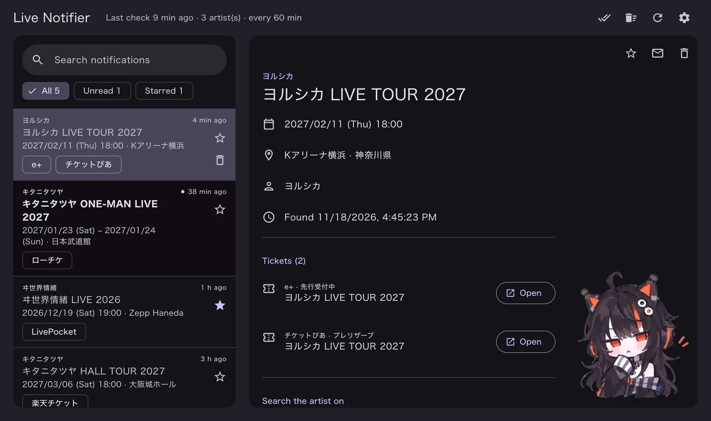
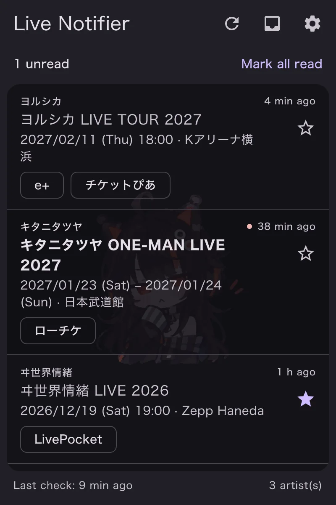
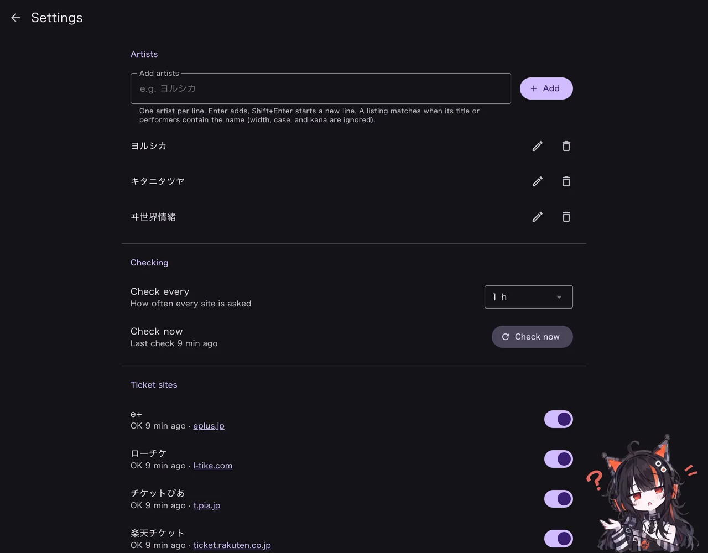

# JP Live Notifier


A Chrome extension (Manifest V3) that tells you when new live and concert listings appear for your
artists on Japan's major ticket sites: **e+**, **ローチケ**, **チケットぴあ**, **楽天チケット**,
**LivePocket**, and **ASOBI TICKET**.

No account, no server, no tracking: everything runs in your browser, and your artist list and
inbox never leave it.

<br clear="right" />



<table>
  <tr>
    <td width="34%"></td>
    <td></td>
  </tr>
  <tr>
    <td align="center">Toolbar popup</td>
    <td align="center">Settings</td>
  </tr>
</table>

<sub>Screenshots use sample data: the artists are real, the shows are invented.</sub>

## Features

- **One inbox for six sites.** The same show on several sites becomes one notification with a
  ticket row per site and sale (先行, 一般発売, …).
- **Quiet first sync.** Adding an artist files what is already on sale as unread, with one summary
  notification, not dozens.
- **Smart matching.** A listing matches when its title or performers contain the artist's name;
  full/half width, case, and hiragana/katakana are ignored. Past shows are dropped.
- **Polite by design.** One request per site at a time, at least 3 s apart, every 30 min to 12 h
  (default 1 h). A site that blocks or fails cools down instead of being retried in a loop.
- **Survives bot checks.** Sites behind a bot shield (LivePocket's AWS WAF) can be passed in a
  background tab, and their posters are kept so they stay visible after the check's pass expires.
- **Email-style inbox.** Search, unread/starred filters, keyboard navigation, star to keep, and
  "clear read" to tidy up. A deleted show does not come back.
- **Material 3 UI** in light and dark, following your system theme.

## Install

Requires Chrome (or another Chromium browser) **130 or later**.

1. Download or clone this repository.
2. Open `chrome://extensions`, turn on **Developer mode**, click **Load unpacked**, and pick the
   [`extension/`](extension/) folder (not the repository root: Chrome refuses folders with
   `node_modules`). After pulling changes, click ↻ on the extension's card.
3. The settings page opens. Add artists, one per line (pasting several lines adds them all).
4. The first check runs at once. What is already on sale goes into the inbox **unread**, with one
   "Now watching" summary. Later finds notify you one by one.

## Use

- **Toolbar popup:** the latest notifications; the badge counts unread ones. Click an item to open
  it in the inbox.
- **Inbox** (list + detail): artist, title, date and time, venue, prefecture, poster, and one row
  per ticket site and sale with a link. ☆ keeps an item (starred items are never cleared). 🗑
  deletes one item; "clear read" removes every read, unstarred item. Keys: `j`/`k` or ↑/↓ to move,
  `s` to star.
- **System notifications:** clicking one opens its detail. More than 3 at once arrive as one
  summary.
- **Settings:** artists, check interval, **Check now**, per-site switches with each site's health,
  the background-tab option, and notification options.

## Privacy and permissions

Nothing is sent anywhere except the ticket sites' own search pages, which the extension asks on
your behalf, as your browser (your cookies for those sites are sent, as when you visit them). Your
artists, inbox, and stored posters stay in `chrome.storage.local` on your computer.

| Permission                          | Why                                                                 |
| ----------------------------------- | ------------------------------------------------------------------- |
| `storage`, `unlimitedStorage`       | Artists, inbox, schedule, and poster copies, kept locally           |
| `alarms`                            | Runs the periodic check                                             |
| `notifications`                     | System notifications for new shows                                  |
| `offscreen`                         | Parses HTML result pages (service workers have no `DOMParser`)      |
| `scripting`                         | Reads the page in the background tab that passes a site's bot check |
| Host access to the six ticket sites | Fetches their search results without CORS limits                    |

## How it works

```text
chrome.alarms (every 30 min – 12 h, default 1 h)
  → queue of (artist × site) jobs, at most one request per site, ≥3 s apart
  → fetch from the service worker (host_permissions: no CORS, your site cookies are sent)
  → parse: JSON directly; HTML in an offscreen document (service workers have no DOMParser)
  → keep upcoming listings whose title/performers contain the artist (NFKC, case, kana folded)
  → group: same show = overlapping dates + similar venue (or title) → one notification, one
    offer row per site
  → seen index (site:id) decides what is new; deleted shows leave a tombstone
  → notification + badge
  → bot-checked sites: up to 5 posters per check are stored as small WebP copies
```

| Site         | Source                                            | Notes                                                                                                                          |
| ------------ | ------------------------------------------------- | ------------------------------------------------------------------------------------------------------------------------------ |
| e+           | `/sf/search` HTML with embedded JSON (first 20)   | No bot shield. robots.txt disallows this path for crawlers; the extension asks for you at a low rate, and you can turn it off. |
| ローチケ     | `/search/` HTML, newest sale first                | Akamai Bot Manager: works from a normal (headed) Chrome; blocked in headless. Ticket link is the `gLcode` order page.          |
| チケットぴあ | `rlsInfo.do` HTML fragment (2 pages)              | No shield. Fuzzy search, filtered locally.                                                                                     |
| 楽天チケット | WordPress search `?s=&q=`                         | No shield. Few listings.                                                                                                       |
| LivePocket   | `/event/search?sort=3` HTML                       | AWS WAF challenge on pages and images: enable the background-tab option, or open the site once.                                |
| ASOBI TICKET | open JSON API (`/v1/public/booths`), local filter | Public data has no venue/performer; the date comes from the booth slug.                                                        |

**Blocked sites.** A 403/429/503, a WAF header, or a page without the site's results marker counts
as a block (never as "no results"). The site cools down (30 min, doubling, max 24 h), and the
settings page shows its state. With the **background-tab** option on, a blocked page is loaded once
in an inactive tab to pass the check, and then fetched again with the new cookie.

## Troubleshooting

- **A site shows "AWS WAF challenge" or another block.** Turn on _Get past bot checks in a
  background tab_, or open the site once in a tab, then press **Check now** (it ends every site's
  cooldown and checks again).
- **A poster shows a placeholder.** The site refused the image (LivePocket refuses images without
  a fresh bot-check pass). The extension stores the poster on a later successful check; it then
  replaces the placeholder.
- **ローチケ is blocked.** Its Akamai shield blocks headless browsers; a normal Chrome window
  usually passes.
- **Nothing new for an artist.** Check the spelling the sites use (カタカナ vs. Latin letters);
  matching ignores width, case, and kana, but not different names.

## Develop

Requires Node.js 24+ and pnpm (`corepack enable`).

```bash
pnpm install
pnpm exec playwright install chromium   # once, for the e2e tests
pnpm check          # lint + format check + typecheck + unit tests
pnpm test           # unit and fixture tests (Vitest)
pnpm test:e2e       # loads the extension in Chromium against saved pages (mocked e2e)
LIVE=1 TAB=1 pnpm exec playwright test live   # one round against the real sites
# HEADED=1 shows the browser; DUMP=1 saves raw responses to tmp/
pnpm icons          # redraw extension/icons
```

The mocked e2e test injects an invented show (【TEST】ヨルシカ ダミー公演 2027) into saved pages;
it exists only in that test's temporary profile. It also writes light and dark screenshots of each
page to `tmp/`.

```text
extension/       the extension itself (manifest.json, icons/, images/, src/)
  src/lib/       pure logic: matching, grouping, inbox, schedule, settings, storage, posters
  src/sites/     one adapter per ticket site
  src/ui/        popup, inbox, settings pages (Material 3, plain CSS)
test/            unit tests; test/fixtures/ holds saved search pages of each site
e2e/             Playwright specs
docs/sites/      research notes per site (endpoints, markup, bot protection)
docs/images/     README screenshots
```

`test/fixtures/` are copies of public search-result pages, kept so the parsers can be tested
offline; anti-forgery tokens in them are replaced with `REDACTED`. The notes in `docs/sites/` also
mention research captures that are not part of this repository.

## Illustrations


Unofficial fan-made work of 「魔法少女ノ魔女裁判」 (AI利用: GPT Image). Not
affiliated with Acacia or 合同会社Re,AER. Shared under the
[fan-creation guidelines](https://manosaba.com/guidelines).

<br clear="right" />

## License

The code is under the [MIT License](LICENSE). These are **not** covered by it:

- **The illustrations** in `extension/images/` (and the screenshots showing them): no license is
  granted; do not reuse them.
- **The saved pages** in `test/fixtures/`: copies of the ticket sites' public pages, kept only as
  test data; they remain the property of their sites.
